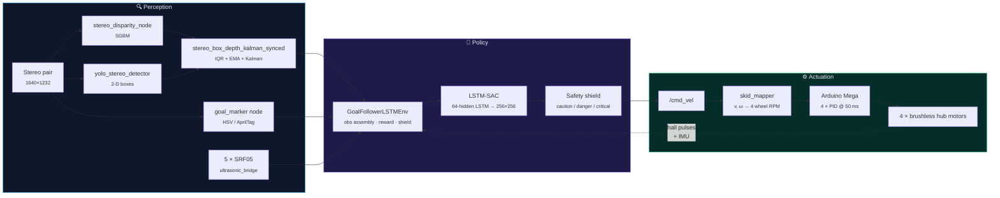
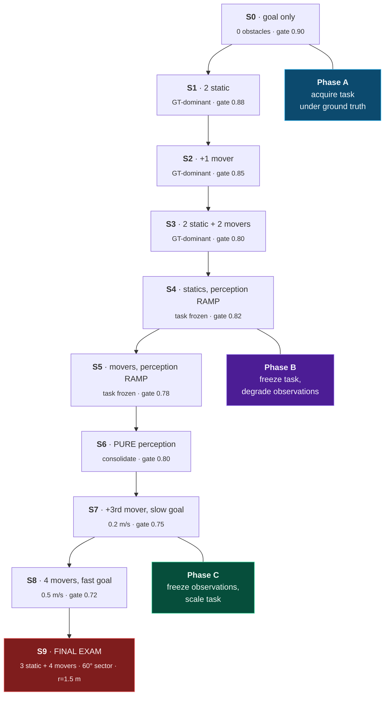

<div align="center">



<br>

**A four-wheel-drive scooter that learns to reach a moving goal through a crowd — using only what its own cameras and sonar can see.**

<br>


<sub>M.Sc. thesis work · School of Mechanical Engineering, University of Tehran · CAST Lab</sub>

</div>

---

## The one-paragraph version

Most mobile-robot navigation stacks assume a map and a clean obstacle list. This one assumes neither. A recurrent SAC policy is trained end-to-end in Gazebo to drive a skid-steer scooter toward a **moving** goal marker while dodging **moving** pedestrians — reading a 15-D proprioceptive/sonar vector plus up to 10 tracked obstacles produced by a YOLO + stereo-disparity + Kalman perception chain. A safety shield sits between the policy and the wheels, and a ten-stage curriculum weans the agent off ground truth onto its own noisy perception. The same message interfaces drive the real chassis: four brushless hub motors under closed-loop PID, five SRF05 sonars, and a calibrated stereo pair.

<details>
<summary><b>🇮🇷 خلاصه فارسی</b></summary>

<div dir="rtl">

این مخزن، پیاده‌سازی کامل ناوبری خودران یک اسکوتر چهارچرخ در محیط‌های پویا است. یک سیاست یادگیری تقویتی از نوع **LSTM-SAC** در Gazebo آموزش می‌بیند تا در حالی که از موانع متحرک اجتناب می‌کند، به یک هدف متحرک برسد. ورودی سیاست شامل یک بردار ۱۵‌بعدی (فاصله و زاویه هدف، سرعت‌ها، پنج سنسور اولتراسونیک، و وضعیت سپر ایمنی) به‌همراه تا ۱۰ مانع ردیابی‌شده توسط زنجیره ادراک (YOLO + اختلاف‌منظر استریو + فیلتر کالمن) است.

سه مؤلفه اصلی مخزن:

- **`Simulation/`** — بسته‌های ROS 2، مدل Gazebo، محیط Gym، و اسکریپت‌های آموزش و ارزیابی
- **`Motors/`** — فریم‌ور آردوینو برای کنترل PID چهار موتور، به‌همراه لاگ‌های آزمون و اسکریپت‌های تحلیل
- **`Calibration/`** — پارامترهای کالیبراسیون دوربین استریو (شبیه‌سازی و واقعی) و نتایج ارزیابی دقت عمق

</div>

</details>

---

## Why this repo is not just "another SAC baseline"

Three design decisions here were forced by bugs that only show up when you actually try to run RL on a real robot's perception. Each is documented in-source.

<table>
<tr>
<td width="33%" valign="top">

### 🛡️ The shield lies to the critic

A safety shield that rewrites actions **breaks standard SAC silently**. The buffer stores `(s, a_policy, r, s′)` — but `a_policy` never executed. When the shield fires 30% of the time, 30% of your replay buffer teaches the critic a fictional dynamics model.

`shielded_sac.py` overrides `_store_transition` to swap in the *executed* action from `info["executed_action_normalized"]`, plus an optional shield-imitation loss that turns the shield from a passive corrector into an active teacher.

</td>
<td width="33%" valign="top">

### 🪜 Two curriculum axes, never both at once

Naive curricula ramp task difficulty and perception noise together, so a plateau tells you nothing about which one broke.

The ladder here moves **exactly one axis per transition**: Phase A acquires skills under ground-truth-dominant observations, Phase B *freezes the task* and ramps observations to pure perception, Phase C freezes observations and scales the task. Obstacle load is capped at 4 movers — the honest observability limit of the sensor suite.

</td>
<td width="33%" valign="top">

### 📡 Perception is the environment

The env doesn't hand the policy a clean obstacle list. It maintains **10 memory slots** with association-by-distance (1.2 m gate) and 30 s expiry, fed by the real detector topics. Missed detections, ID swaps and late tracks are part of the MDP, not abstracted away.

`start_gt_blend()` mixes ground truth into observations with probability `p_gt` that decays to zero — a dial from "oracle" to "sensors only."

</td>
</tr>
</table>

---

## System architecture



### What the policy actually sees

```
observation = {
  fixed      : 15-D  ┌─ goal_dist, goal_bearing, goal_rel_vx, goal_rel_vy   (4)
                     ├─ v, ω                                                 (2)
                     ├─ ultra_fl, ultra_fr, ultra_ls, ultra_rs, ultra_back   (5)
                     ├─ prev_v, prev_ω                                       (2)
                     └─ shield_severity, shield_duration_norm                (2)

  obstacles  : 10×5  └─ [x, y, depth, rel_vx, rel_vy]  per tracked slot

action       : 2-D   └─ [v, ω] ∈ [-1,1]²  →  v_max 1.0 m/s, ω_max 1.0 rad/s
                        α = 0.70 exponential smoothing, dt = 0.1 s
}
```

Telling the policy about the shield (`shield_severity`, `shield_duration_norm`) is deliberate: an agent that can't observe its own constraint violations can't learn to avoid them, only to be corrected out of them.

---

## The curriculum ladder



Behaviour-cloning weight against the ground-truth teacher is **stage-keyed, not timestep-annealed** — it peaks at `β = 2.0` exactly where the student's observations are least trustworthy (Phase B), then releases to `0.15` by Stage 9 so the student can outgrow the teacher's blind spots.

Advancement requires *both* a success-rate gate over a rolling window *and* a minimum episode count, so a lucky streak can't promote an undertrained policy.

---

## Repository map

```
Autonomous-Scooter/
├── Simulation/Gazebo/src/          ← 13 ROS 2 packages
│   ├── sac_goal_follower/          ← 🧠 the RL core
│   ├── detectors/                  ← YOLO + stereo depth + Kalman tracking
│   ├── stereo_vision_pkg/          ← disparity, Pi camera receiver, visualisers
│   ├── four_wheel_robot/           ← URDF/xacro, warehouse worlds, spawn launches
│   ├── follower_obstacle_spawner/  ← on-demand obstacle spawning via /obstacle_config
│   ├── moving_obstacle_plugins/    ← C++ Gazebo plugin: pedestrian motion
│   ├── goal_marker_description/    ← the moving goal + its mover node
│   ├── ultrasonic_bridge/          ← C++ sonar → sensor_msgs/Range
│   └── scooter_nav/                ← classical baselines (min_avoid, zone search)
├── Motors/                         ← ⚙️ firmware + bench characterisation
├── Ultrasonics/                    ← 📡 5×SRF05 parallel-group firing
└── Calibration/                    ← 📐 stereo intrinsics + depth accuracy study
```

<details>
<summary><b>Inside <code>sac_goal_follower/</code> — what each file is for</b></summary>

| File | Role |
|---|---|
| `goal_env_lstm.py` | The environment. Obs assembly, obstacle memory, reward shaping, shield, GT-blend schedule. |
| `goal_env_gt.py` | Ground-truth variant used to train the teacher. |
| `lstm_sac_policy.py` | Recurrent feature extractor — obstacle sequence → LSTM(64) → concat with fixed 15-D → MLP(256,256). |
| `shielded_sac.py` | SAC subclass fixing the shield/replay-buffer dynamics mismatch + shield-imitation loss. |
| `distilled_sac.py` | Teacher→student distillation with a BC term in the actor loss. |
| `train_curriculum_lstm_sac.py` | **Main entry point.** 10-stage ladder, resume-aware via `curriculum_log.json`. |
| `frame_stack_wrapper.py` | Temporal stacking for the non-recurrent ablations. |
| `mpc_policy.py` | MPC baseline for comparison. |
| `evaluation_curriculum_lstm.py` | Stage-wise evaluation harness. |
| `export_onnx.py` | Policy export for on-robot inference. |
| `policy_meta.json` | Frozen hyperparameters — the contract between training and deployment. |

</details>

<details>
<summary><b>Inside <code>Motors/</code> — the firmware evolution</b></summary>

The bench work is kept in-tree because the *conclusions* are load-bearing for the sim:

| Directory | What it established |
|---|---|
| `motor1_test/` | Open-loop characterisation of one motor. Hall-period RPM estimation showed spikes and dropouts. |
| `combined_controller_window_rpm/` | Replaced period-based RPM with a **200 ms pulse-count window** + EMA. Clean feedback at last. |
| `combined_controller_window_rpm_motor_only/` | Four-motor closed loop, keyboard and joystick teleop, IMU-fused odometry logging. |
| `controller_PID/` | Gain tuning after the 30/50/70 RPM sweep showed overshoot. |

One bug fix worth reading in `combined_controller_window_rpm_motor_only.ino`: with `pulsesPerRev = 45`, the old 500 ms stale timeout **falsely zeroed a genuinely turning wheel** below 2.67 RPM, because the true inter-pulse gap already exceeds the timeout there. Raised to 2000 ms — a slowly-turning wheel intermittently reporting zero is far more harmful than a stopped wheel reporting non-zero for an extra second.

Wire protocol (Arduino ⇄ host):

```
→  SP#+RRR#+RRR#+RRR#+RRR\n           setpoints, four wheels
←  rpm0..3, err0..3, out0..3          telemetry
←  S:d0,d1,d2,d3,d4                   five sonar ranges (cm)
```

</details>

<details>
<summary><b>Inside <code>Calibration/</code> — the depth accuracy study</b></summary>

Stereo intrinsics are stored per resolution for both the simulated and real cameras:

| Set | Resolution | Notes |
|---|---|---|
| `calibration_data_simulation_640_480` | 640×480 | `left.yaml` / `right.yaml`, ROS `camera_info` format |
| `calibration_data_simulation_1640_1232` | 1640×1232 | matches the Pi camera native mode |
| `calibration_data_real_camera_640_480` | 640×480 | includes an `_old` set for regression comparison |
| `calibration_data_real_camera_1920_1080` | 1920×1080 | |
| `calibration_data_real_1640_1232` | 1640×1232 | **primary** — plus the depth experiment |

`depth_experiment_results.csv` logs each measurement with ground-truth distance, measured depth, absolute and percentage error, in-band pixel count, ROI coverage and a `GOOD`/`MARGINAL` quality flag — with upscale and downscale variants so the resolution-vs-accuracy trade-off is measurable rather than assumed. `diagnose_rectification.py` catches epipolar misalignment before it silently poisons every depth estimate downstream.

</details>

---

## Quick start

> **Prerequisites** — Ubuntu 22.04 · ROS 2 Humble · Gazebo Classic 11 · Python 3.10 · PyTorch + `stable-baselines3` · `gymnasium` · `ultralytics` · OpenCV

<details open>
<summary><b>1 · Build the workspace</b></summary>

```bash
git clone https://github.com/mohammadabedi1179/Autonomous-Scooter.git
cd Autonomous-Scooter/Simulation/Gazebo
colcon build --symlink-install
source install/setup.bash
```

</details>

<details>
<summary><b>2 · Launch the simulation</b></summary>

```bash
# world + robot + controllers
ros2 launch four_wheel_robot launch_sim.launch.py

# the moving goal marker
ros2 launch four_wheel_robot spawn_moving_goal.launch.py

# obstacles, driven by /obstacle_config
ros2 run follower_obstacle_spawner random_obstacle_spawner
```

</details>

<details>
<summary><b>3 · Bring up perception</b></summary>

```bash
ros2 launch stereo_vision_pkg stereo_pipeline.launch.py
ros2 run detectors yolo_stereo_detector_disparity_light
ros2 run detectors stereo_box_depth_kalman_synced
```

</details>

<details>
<summary><b>4 · Train</b></summary>

```bash
ros2 run sac_goal_follower train_curriculum_lstm_sac
```

Resume-aware — it restores the curriculum stage from `curriculum_log.json`, so an interrupted run picks up where it stopped rather than restarting Stage 0. Trajectories are checkpointed every 100 episodes.

</details>

<details>
<summary><b>5 · Evaluate</b></summary>

```bash
ros2 run sac_goal_follower evaluation_curriculum_lstm
ros2 run sac_goal_follower test_sac          # single-model report
```

</details>

<details>
<summary><b>6 · Drive the real chassis</b></summary>

```bash
# flash Motors/combined_controller_window_rpm_motor_only/*.ino to the Mega
python3 Motors/combined_controller_window_rpm_motor_only/joystick_drive_imu_fused_odometry_v2.py
python3 Motors/combined_controller_window_rpm_motor_only/plot_keyboard_imu_fused_odometry.py   # post-hoc plots
```

Start with the wheels lifted and small setpoints. The firmware ramp-limits serial commands before they enter the PID, but that is a safety net, not a substitute for a bench test.

</details>

---

## Reading the results

Evaluation runs emit a structured report rather than a single number, because "success rate" alone hides the failure mode you care about. From `sac_goal_follower/logs/test_report.txt`, a static-goal / 3-static-obstacle run over 50 deterministic episodes:

| Metric | Value |
|---|---|
| Success | 78.0% |
| **Collision** | **0.0%** |
| Timeout | 22.0% |
| Steps per metre (successes) | median 10.8 |
| Min obstacle depth | mean 1.90 m · worst 0.91 m |
| Min sonar clearance | mean 0.89 m · worst 0.40 m |
| Shield intervention rate | mean 1.2% · worst 18.3% |

The interesting line is the third: every non-success was a **timeout, never a collision**. The policy learned to be conservative before it learned to be fast — which is the correct order for a vehicle that shares space with people, and it means the remaining 22% is a shaping problem rather than a safety one.

> ℹ️ These numbers come from one specific checkpoint on one configuration. Curriculum Stage 9 results live under the run directories produced by `train_curriculum_lstm_sac`; regenerate rather than cite this table for anything downstream.

---

## Design notes worth stealing

<table>
<tr><td width="50%" valign="top">

**Ultrasonic group firing.** Five SRF05s fired sequentially with `pulseIn()` gives ~4 Hz — too slow to be part of a 10 Hz control loop. Firing them in two crosstalk-safe groups (`{right-front, left-side, rear}` then `{left-front, right-side}`) with a single tight multi-pin polling loop gets **10 Hz on stock pins**, no interrupts, no rewiring. Median-of-5 filtering on top.

</td><td width="50%" valign="top">

**Range caps must agree.** The sonar max range appears in three places — the Gazebo SDF `<max>`, the bridge clamp, and the env's `ultra_max_range`. The lowest wins, silently. When the SDF plugins moved from 1 m to 3 m, the env had to follow or two-thirds of every reading was clipped to a wall that wasn't there. Documented inline where it bites.

</td></tr>
<tr><td width="50%" valign="top">

**Cost caps as an economics guard.** An early run let per-episode shield cost balloon to ~1300, so the Lagrangian penalty dwarfed the +50 goal reward and the optimal policy became *don't move*. `shield_cost_cap = 25.0` bounds the accrual; the uncapped value is still logged for diagnostics.

</td><td width="50%" valign="top">

**Reset order matters in Gazebo.** Obstacle poses read while physics is paused return stale data, so obstacles spawn where they used to be. `reset()` unpauses physics *before* pose sync, then re-pauses. A one-line ordering bug that costs days if you assume the simulator is telling you the truth.

</td></tr>
</table>

---

## Roadmap

- [x] Stereo calibration + depth accuracy characterisation
- [x] Four-motor closed-loop PID with window-RPM feedback
- [x] Gazebo model, warehouse worlds, moving-obstacle plugins
- [x] LSTM-SAC with passive shield + Lagrangian cost
- [x] Ten-stage decoupled curriculum with teacher distillation
- [x] ONNX export path
- [ ] Sim-to-real transfer of the Stage 9 policy onto the physical chassis
- [ ] Domain randomisation over lighting and detector latency
- [ ] Evaluation-only stress suite at 5 and 7 movers (beyond sensor observability)
- [ ] Paper submission — ICRoM

---

## Citation

If this work is useful to you:

```bibtex
@mastersthesis{abedi2026scooter,
  author  = {Abedi, Mohammad Mahdi},
  title   = {Autonomous Navigation of a Four-Wheel-Drive Scooter in Dynamic
             Environments Using Deep Reinforcement Learning},
  school  = {University of Tehran},
  year    = {2026},
  type    = {M.Sc. Thesis},
  note    = {\url{https://github.com/mohammadabedi1179/Autonomous-Scooter}}
}
```

## Acknowledgements

Warehouse environment meshes and textures under `four_wheel_robot/models/aws_robomaker_warehouse_*` are from the [AWS RoboMaker Small Warehouse World](https://github.com/aws-robotics/aws-robomaker-small-warehouse-world), used under Apache-2.0. Built on [Stable-Baselines3](https://github.com/DLR-RM/stable-baselines3), [Gymnasium](https://github.com/Farama-Foundation/Gymnasium), and [Ultralytics YOLO](https://github.com/ultralytics/ultralytics).

## License

<!-- TODO: add a LICENSE file at the repo root, then update this line. MIT is the usual choice for thesis code. -->
No license file is present yet — until one is added, all rights are reserved and the code is not licensed for reuse.

<div align="center">
<br>
<sub>Questions or collaboration → open an issue.</sub>
</div>
